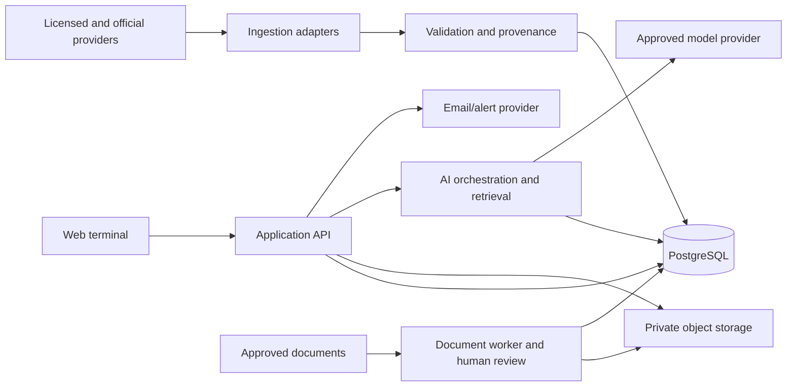

# Architecture and Data Model

## Recommended system shape

Start with a modular monolith and managed PostgreSQL. Keep the web/API application, ingestion worker and document-processing worker as deployable processes with clear interfaces; do not split into many microservices before scale requires it.

### Modules

- **Identity and tenancy:** users, roles, organisations, memberships, plan entitlements.
- **Platform staff:** internal editorial and research roles, held separately from platform administration.
- **Provider registry:** adapter configuration, credentials references, licence terms, allowed purposes and contact/renewal details.
- **Ingestion:** manual document upload first, then scheduled collectors; immutable source payload references, normalization, validation, deduplication and correction history.
- **Financial domain:** companies, instruments, prices, fundamentals, economic observations, fixed-income terms/yields.
- **Announcements and corporate actions:** issuer and exchange communications, and the dated entitlements they create.
- **Public offers:** IPOs and other offers, their structure, revisable timelines, official documents, disclosed risks and authorised participation channels.
- **Editorial:** drafting, financial review, fact-checking, publication and correction, with citations into source documents.
- **Intelligence:** retrieval, deterministic financial calculations, generated analyses, citations, safety policy and evaluation records.
- **User services:** search, watchlists, alerts, notifications and usage limits.
- **Administration:** approvals, audit logs, provider freshness and exception queues.

### Delivery priority

The core of the product is **Nigerian listed companies**: who they are, what they
file, what their financials say, and how those figures move — margins, growth and
ratios, shown as charts — together with IPOs and public offers. Everything else
is support for that.

`docs/blueprints/` remains the source of truth for scope, and its MVP is
editorial-first. Build order follows depth on listed companies, not breadth of
asset class.

Order of work:

0. **Editorial** (stage 2c, in progress): articles and analysis that cite
   approved documents and published announcements, plus a lightweight video kind
   that is a link to YouTube — no uploads, no streaming, no media pipeline.
1. **Company pages:** profile, its documents, its announcements, financial
   history drawn from approved annual reports, and computed metrics — margins,
   growth, ratios — presented as charts. This is the centre of the product.

   Financial history is **entered by an analyst first, not extracted**. Each
   figure cites the document it came from and the page it appears on, so a reader
   can check any number against the filing. Machine extraction arrives later, in
   the Python worker, and will propose figures into the same review queue rather
   than writing them directly — the extraction becomes a suggestion a person
   approves, never a published number. Building the manual path first means the
   citation and review model is proven before anything automated depends on it.
2. **Dividends.**
3. **IPO and public-offer centre.**
4. **Public homepage**, the first surface visible without signing in.
5. **Share prices**, only once an NGX licence exists. Nothing here waits on it.

Fixed income and macroeconomic series are **frozen**: the schema, catalogues and
routes already built are kept and maintained, but no new work is scheduled on
them. Audio is not planned. Video exists only as an editorial item holding a
YouTube video id and a guest name.

Editorial content sits **beside** the provider/dataset machinery rather than inside
it. A dataset describes licensed third-party material arriving through ingestion;
SFI's own writing is not ingested and has no provider licence, so it carries no
`dataset_id` or `source_record_id`. It earns its authority by citing documents and
approved observations, and by passing human review.

## Data lifecycle

1. An adapter obtains an allowed provider record and stores provider ID, source URI, retrieval time and original payload/reference.
2. Normalization maps source values into typed canonical records without losing original units, period labels or provider identifiers.
3. Validation checks schema, units, dates, duplicate keys, range anomalies and expected freshness. Failures are quarantined for review.
4. Approved observations become queryable; corrections append a version and retain the old value and reason.
5. The API returns value, source, as-of time, period, status and rights-aware display metadata together.
6. AI retrieves these records and citations; it does not source unsupported facts from model memory for numeric answers.

## Core relational model

Use PostgreSQL `numeric` for all financial values; avoid binary floating point. Normalize units/currencies and keep observed, published, retrieved and effective dates distinct.

| Entity | Key fields and relationships |
| --- | --- |
| `users`, `user_profiles` | Auth identity, profile and preferences |
| `organisations`, `organisation_members` | Tenant and membership role; private records include `organisation_id` |
| `roles`, `permissions`, `user_roles` | Platform and tenant-scoped authorization |
| `subscription_plans`, `subscriptions`, `entitlements` | Configurable plans, provider-neutral status and quotas |
| `data_providers`, `data_licenses` | Provider, contract reference, permitted products, display/redistribution rights, expiry |
| `ingestion_jobs`, `source_records`, `data_quality_checks` | Job status, source payload pointer/hash, retrieval time, validation outcomes |
| `companies`, `sectors`, `company_identifiers` | Canonical issuer identity and symbol/ISIN mappings with effective dates |
| `instruments` | Issuer, asset class, exchange, currency, instrument identifiers and lifecycle |
| `market_observations` | Instrument/series, observation time, `numeric` value, unit, currency, source record, rights and status |
| `market_snapshots`, `market_indices` | Index or market summaries; computed values record methodology/version |
| `financial_periods`, `financial_statement_lines` | Company, statement type, period start/end, filed/published date, line item, value, currency/unit, source and revision |
| `financial_metric_definitions`, `derived_metrics` | Formula/version, period alignment, inputs, output and calculation timestamp |
| `economic_series`, `economic_observations` | Indicator definition and dated/revisable observations |
| `fixed_income_terms`, `auction_events`, `auction_results`, `yield_observations` | Issue terms, event dates, result type and yield basis clearly distinguished |
| `announcements` | Issuer or market communication: category, headline, announced time, price sensitivity, source document |
| `corporate_actions` | Instrument, action type, progressive dates (declared, ex, closure, AGM, payment), per-share amount and withholding, ratio for bonus/rights/splits |
| `public_offers` | Issuer, offer and security type, status, fixed price or book-build range, units, minimum application, use of proceeds |
| `public_offer_milestones` | Dated opening, closing, extension, allotment and listing events; revisable, each change a new version |
| `public_offer_documents` | Offer to document, with the document's role (prospectus, abridged particulars, exchange notice, regulator approval, allotment) |
| `public_offer_risks` | Risk category and summary **as disclosed**, resolving to `document_id` and `source_page` |
| `public_offer_participation_channels` | Authorised channel, type, link and the reviewer who verified it; SFI never collects funds |
| `documents`, `document_extractions`, `document_chunks` | Private object pointer, rights, extracted text/table, page references, review state and reviewer |
| `document_review_events` | Append-only document review history: actor, state transition and reason |
| `platform_staff` | Internal editorial and research roles, separate from `platform_admins` |
| `editorial_items`, `editorial_revisions` | Article, explainer, briefing or glossary entry; workflow state, distinct author/reviewer/fact-checker/publisher, AI provenance, append-only bodies |
| `editorial_citations` | Claim to supporting document page or approved observation |
| `editorial_transitions` | Append-only editorial workflow audit trail |
| `watchlists`, `watchlist_items`, `alerts`, `notifications` | Owner/tenant, rule, delivery state and history |
| `ai_conversations`, `ai_messages`, `ai_citations`, `ai_runs` | User/tenant, model/prompt version, retrieved evidence, output, cost and evaluation status |
| `audit_logs`, `api_keys`, `usage_records` | Actor, action, target, request metadata and usage/entitlement accounting |

### Editorial workflow

States: `draft` → `published` → `superseded` (a correction replaced it) or
`withdrawn`. Transitions are enforced by trigger, not by application code.

A draft is freely editable; a published item is not. That one rule removes the
need for a separate revision table: the versions *are* the history, exactly as
with announcements and observations.

Three rules carry the weight:

1. **Citations before publication.** Publishing an article or analysis requires at
   least one citation resolving to an approved document (with its page) or a
   published announcement. A video carries a guest, not a filing, so it is exempt.
2. **AI-assisted work is labelled to readers.** Where `ai_assisted` is set the
   model must be named, and the reader sees an "AI-assisted" label on the item.
   The blueprints' rule is that AI-generated conclusions are never passed off as
   analyst work; saying so on the page is what keeps that true.
3. **Self-review is flagged, not blocked.** Where the publisher is also the
   author, `self_reviewed` records it, the audit log carries it, and the desk shows
   it — the same stance taken for self-approved documents and self-published
   announcements. Enforcement waits for a second person; the switch is a setting,
   not a code change.

Corrections publish a new version and mark the old one superseded, with a reason.
Withdrawal requires a reason and keeps the item visible, labelled: something that
was published and then vanished is worse than something openly retracted. Readers
see `published` and `withdrawn`; staff also see drafts and superseded versions.

Nothing here is ever edited in place or deleted, and `audit_logs` is itself
append-only, since this workflow relies on it as the record of who did what.

### Ingestion sequencing

Ingestion arrives in two stages, deliberately in this order:

1. **Manual document upload with analyst review.** A staff member uploads an
   official document; the server computes its checksum, stores it in private object
   storage and records an `upload` ingestion job and a source record. Nothing is
   visible to readers until a reviewer approves it. This proves the review path and
   the provenance chain with no external dependency.
2. **Automated collectors, as a separate Python worker.** Per the blueprints'
   stack, a standalone service detects, downloads, classifies and extracts. It
   writes only ingestion jobs, source records, pending documents and extractions —
   never an approved row — and connects through a dedicated insert-only database
   role rather than the service key. Public sources (CBN, NBS) come first; NGX
   datasets cannot be activated until a display licence is recorded.

### Integrity and indexing

- Unique constraints on provider + provider record ID + version; canonical identifier effective-date uniqueness.
- Foreign keys from observations, statements, reports and AI citations to provenance records.
- Time-series indexes on `(instrument_id, observation_at)` and `(series_id, observation_period_end)`; company-period indexes on financial statements.
- Partial indexes for active alerts, pending reviews and latest approved observations.
- Tenant row-level security for organisation-owned records; server-side permission checks remain mandatory.
- Partition large observation tables by date after measured growth justifies it.
- Store uploaded documents in private object storage; database holds object key, checksum and classification.

## API boundaries

Versioned REST endpoints should return typed domain records, not provider payloads. Example groups: `/v1/markets`, `/v1/companies`, `/v1/announcements`, `/v1/offers`, `/v1/editorial`, `/v1/education`, `/v1/economy`, `/v1/fixed-income`, `/v1/search`, `/v1/assistant`, `/v1/watchlists`, `/v1/admin/documents`, `/v1/admin/providers`.

Source documents are never served from the application origin. A reader is given a
short-lived signed URL minted server-side for a specific object; the storage bucket
is closed to every client role.

Provider adapters implement a common interface such as `fetch(cursor, window)`, `normalize(record)`, `validate(record)` and `rights(product, use)`. Secrets are injected server-side from a secret manager/environment and never serialized into frontend bundles or logs.

## Initial technology direction

- Next.js + React + TypeScript web application.
- PostgreSQL (Supabase is a reasonable managed starting option), migrations and row-level security where appropriate.
- Separate scheduled ingestion/document workers; Python is suitable for document extraction if needed.
- Private object storage for source documents and exports.
- Provider-neutral AI orchestration with retrieval and structured outputs.
- Financial charting library selected after data licensing and accessibility requirements are confirmed.
- Hosting selected after region, recovery, privacy and cost review. Avoid committing to an unverified vendor configuration.
