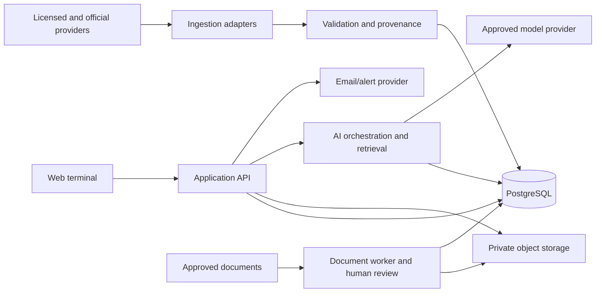

# Architecture and Data Model

> Roadmap ordering, the entitlements layer, the provider adapter layer and the
> planned data-model additions follow `docs/blueprints/SFI_ARCHITECTURE_V2.md`,
> which supersedes earlier ordering where they conflict. Sections it marks
> **(brainstorm)** are direction, not decisions;
> `docs/blueprints/BUSINESS_AND_FUTURE.md` holds the longer-range thinking.
>
> `docs/blueprints/CEO_STRATEGY.md` is the CEO's own strategy and coverage
> documents (November 2026). It is a business brief, not a build spec: where it
> names technology, V2 §11 records what this codebase does instead and why. What
> it decides — the pilot universe, the indicator sets, the per-figure fields —
> is binding, and is reflected below.

## Recommended system shape

Start with a modular monolith and managed PostgreSQL. Keep the web/API application, ingestion worker and document-processing worker as deployable processes with clear interfaces; do not split into many microservices before scale requires it.

### Modules

- **Identity and tenancy:** users, roles, organisations, memberships, plan entitlements.
- **Platform staff:** internal editorial and research roles, held separately from platform administration.
- **Provider registry:** adapter configuration, credentials references, licence terms, allowed purposes and contact/renewal details.
- **Ingestion:** manual document upload first, then scheduled collectors; immutable source payload references, normalization, validation, deduplication and correction history.
- **Financial domain:** companies, instruments, prices, fundamentals, economic observations, fixed-income terms/yields.
- **Announcements and corporate actions:** issuer and exchange communications, and the dated entitlements they create.
- **Public offers:** IPOs and other offers, their structure, revisable timelines, official documents, disclosed risks and authorised participation channels.
- **Editorial:** drafting, financial review, fact-checking, publication and correction, with citations into source documents.
- **Intelligence:** retrieval, deterministic financial calculations, generated analyses, citations, safety policy and evaluation records.
- **User services:** search, watchlists, alerts, notifications and usage limits.
- **Administration:** approvals, audit logs, provider freshness and exception queues.

### Key boundaries

Four boundaries carry the architecture. Each exists so that a later change lands
in one place instead of across every page.

- **Provider adapter layer.** Every outside data or AI service connects through a
  single adapter holding its own credentials, licence metadata and kill switch.
  That covers more than market-data feeds: extraction, OCR, LLM, email and
  payment providers too, each configured in the provider registry rather than
  arriving as bare environment variables and direct calls. Swapping a provider
  never touches pages. The interface stays `fetch(cursor, window)`,
  `normalize(record)`, `validate(record)` and `rights(product, use)`.
- **Market data service boundary.** Prices sit behind one interface, so
  end-of-day data can later be replaced by a real-time stream without rewriting
  pages.
- **Entitlements layer.** One place decides what each tier — free, premium,
  institutional, API — may see, and enforces licence limits such as NGX prices
  being visible only to tiers the licence covers. Built in Phase 5, early and
  deliberately: every later revenue stream depends on it, and retrofitting it
  across finished pages is the expensive version of the same work. No feature
  grows its own notion of "is this user allowed".
- **AI reads only approved data, and cites it.** No privileged database path, no
  ability to write to the core, and no published claim without a citation a
  reader can follow to a filing and a page.

An adapter, a collector or a model writes **pending** work only. Approval is a
human act and it is recorded.

### One core, four faces

The core of the product is **Nigerian listed companies**: who they are, who runs
them, what they file, what their financials say, and how those figures move —
margins, growth and ratios, shown as charts — together with IPOs and public
offers. Everything else is support for that.

One data core is delivered through four surfaces, built in this order:

| Face | For | Arrives |
| --- | --- | --- |
| **Terminal** | Professionals: PFAs, asset managers, brokers, analysts | Phase 3 onward (building now) |
| **Public site** | Everyone — front page, news, research, video, IPO calendar | Phase 5 |
| **AI analyst** | Premium and institutional users, answers cited to approved data | Phase 8 |
| **Data API** | Fintechs, banks, media | Phase 9 |

The moat is a clean, verified, machine-readable history of Nigerian companies in
which **every figure traces to its source document and page**. SFI owns that
core; outside services plug into it, never the other way round.

### Delivery priority

Build order follows depth on listed companies, not breadth of asset class.
`docs/blueprints/SFI_ARCHITECTURE_V2.md` §6 is the authoritative roadmap; this is
its shape, with what each phase means for the code.

**Done** — foundation (app shell, auth, schema, source registry, provenance,
security headers, CI); **2a** documents; **2b** announcements; **2c** editorial.

**Phase 3 — Company intelligence** (in progress)

- **3a Profiles.** Admin registry desk, company pickers on the document,
  announcement and editorial desks, `/companies` directory, `/companies/[slug]`,
  old-slug redirects, reader verification against the real project.
- **3b People and leadership** *(done)*. Executives and board members with tenures, each
  role citing the document and page, or the announcement, that evidences it. The
  leadership record is published. A "company performance during tenure" panel
  shows sourced company facts beside the tenure dates and nothing more: **no
  scores, no rankings, no causal claims**, and "No data yet" until 3c and 3d
  deliver figures. Held to the personal-data standard under Future hooks. Peer
  comparison is deferred.
- **3c Financial entry desk** *(next)*. An editable **catalogue** of statement
  templates: core indicators every company reports, plus the six sector sets from
  the CEO's coverage document — bank, telecoms, cement and industrial, food and
  consumer, oil and gas, power and utilities. Operating metrics (NPL ratio,
  capital adequacy ratio, subscribers, ARPU, tonnes, boe/d, MWh) are stored as
  **reported disclosures, never computed**: they come off a filing like any other
  figure, because a ratio a bank discloses under its own regulator's definition is
  not the same number as one SFI divides out, and only the disclosed one is
  citable. Every figure carries the **original reported figure and a standardised
  figure** side by side, currency (Airtel Africa reports in USD; any naira
  conversion is labelled as a conversion), units (₦'000 / million / billion),
  period — FY or interim, with its dates — consolidated or company-only,
  audited or unaudited, restatement status, source document plus page, and a
  verification date. Restatements are **new versions**, never edits. A year that
  is missing or unverified reads **"Pending verification"** and is never
  estimated. Predecessor and restructured entities (Access Holdings, BUA Foods,
  Aradel) link to their predecessor's history, which is **kept separate** rather
  than spliced into one series. Maker-checker throughout, solo work allowed but
  flagged. AI-assisted extraction proposes figures from a PDF for a human to
  verify one at a time, and anything it touched is labelled AI-assisted.
  **Licences reach figures too:** the statement policy tests
  `is_displayable_source`, so an issuer's own filings display only once the terms
  under which SFI may show them are recorded as an active `data_licences` row
  for `issuer_ir` and the `companies.documents` dataset is switched on.
  Deactivating that dataset hides every figure that came through it at once,
  which is the point of gating on the licence rather than on a copy of its terms
  taken at entry.
- **3d Metrics and charts.** System-calculated margins, growth and ROE with
  recorded formula versions, financial history charts, a **coverage score** per
  company, the five company-page tabs (Overview, Financials, Ratios, Dividends,
  Annual Reports), and a five-year comparison download. Valuation ratios — P/E,
  P/B, market capitalisation, dividend yield, the 52-week range — need share
  prices and so wait for the NGX licence; accounting ratios do not and ship here.
- **3e Dividends and corporate actions.** History, dates, charts.

Financial history is **entered by an analyst first, not extracted**. Each figure
cites the document it came from and the page it appears on, so a reader can check
any number against the filing. Machine extraction arrives in Phase 7, in the
Python worker, and proposes figures into the same review queue rather than
writing them directly — a suggestion a person approves, never a published number.
Building the manual path first means the citation and review model is proven
before anything automated depends on it.

**The pilot universe** is the 18 companies of `SFI_ARCHITECTURE_V2.md`
Appendix A, over FY2021–FY2025, from audited consolidated annual reports — 90
reports, which is a collection schedule and not a claim that any of them have
been collected. Flour Mills of Nigeria is excluded until its listing status is
confirmed. Every ticker, listing status and sector is verified against the NGX
directory **before** anything is seeded, because a wrong ticker is a wrong
company and the whole register is built on identity. Seeding runs on `sfi-dev`
only, writes names, tickers, sectors and template assignments, and writes **no
figures**: a company with no verified figures shows "No data yet", never a
plausible-looking number.

**Later phases**

4. **IPO centre.** Offers, versioned timelines, prospectus library, risks with
   page references, authorised channels only, post-listing status, IPO calendar.
5. **Public front and accounts.** The public homepage (no login), free
   registration, **entitlements with Paystack/Flutterwave subscriptions**,
   watchlists, email alerts, methodology and corrections pages, mobile-first and
   low-data mode.
6. **Pilot launch** (~100 users). Production Supabase Pro and Vercel Pro,
   monitoring, backups, staff MFA, disclaimers approved by counsel, a light
   external penetration test, a design-partner cohort.
7. **Collectors** (Python worker). Macro is unfrozen here: CBN/NBS collectors,
   issuer and NGX document detection, change detection, quality checks. Writes
   only pending rows; humans approve.
8. **AI analyst v1.** Retrieval over approved data with citations; company, CEO
   and prospectus Q&A; human-reviewed daily briefing drafts; the event-impact
   map. **Legal gate:** no buy/sell advice or success rates until counsel clears
   it.
9. **Data API and market data.** Keys, scopes, rate limits, metering, docs,
   billing. NGX prices once licensed — end-of-day first — and authorised-vendor
   status before redistributing prices through the API.
10. **Scale.** Azure migration, team seats and SSO, real-time prices and
    streaming, live video, SFI indices, research subscriptions.

Fixed income and macroeconomic series stay **frozen until Phase 7**: the schema,
catalogues and routes already built are kept and maintained, but no new work is
scheduled on them before the collectors arrive. Audio is not planned. Video is an
editorial item holding a YouTube video id and a guest name until Phase 10.

Editorial content sits **beside** the provider/dataset machinery rather than inside
it. A dataset describes licensed third-party material arriving through ingestion;
SFI's own writing is not ingested and has no provider licence, so it carries no
`dataset_id` or `source_record_id`. It earns its authority by citing documents and
approved observations, and by passing human review.

## Data lifecycle

1. An adapter obtains an allowed provider record and stores provider ID, source URI, retrieval time and original payload/reference.
2. Normalization maps source values into typed canonical records without losing original units, period labels or provider identifiers.
3. Validation checks schema, units, dates, duplicate keys, range anomalies and expected freshness. Failures are quarantined for review.
4. Approved observations become queryable; corrections append a version and retain the old value and reason.
5. The API returns value, source, as-of time, period, status and rights-aware display metadata together.
6. AI retrieves these records and citations; it does not source unsupported facts from model memory for numeric answers.

## Core relational model

Use PostgreSQL `numeric` for all financial values; avoid binary floating point. Normalize units/currencies and keep observed, published, retrieved and effective dates distinct.

| Entity | Key fields and relationships |
| --- | --- |
| `users`, `user_profiles` | Auth identity, profile and preferences |
| `organisations`, `organisation_members` | Tenant and membership role; private records include `organisation_id` |
| `roles`, `permissions`, `user_roles` | Platform and tenant-scoped authorization |
| `subscription_plans`, `subscriptions`, `entitlements` | Configurable plans, provider-neutral status and quotas |
| `data_providers`, `data_licenses` | Provider, contract reference, permitted products, display/redistribution rights, expiry |
| `ingestion_jobs`, `source_records`, `data_quality_checks` | Job status, source payload pointer/hash, retrieval time, validation outcomes |
| `companies`, `sectors`, `company_identifiers` | Canonical issuer identity and symbol/ISIN mappings with effective dates |
| `instruments` | Issuer, asset class, exchange, currency, instrument identifiers and lifecycle |
| `market_observations` | Instrument/series, observation time, `numeric` value, unit, currency, source record, rights and status |
| `market_snapshots`, `market_indices` | Index or market summaries; computed values record methodology/version |
| `financial_periods`, `financial_statement_lines` | Company, statement type, period start/end, filed/published date, line item, value, currency/unit, source and revision |
| `financial_metric_definitions`, `derived_metrics` | Formula/version, period alignment, inputs, output and calculation timestamp |
| `economic_series`, `economic_observations` | Indicator definition and dated/revisable observations |
| `fixed_income_terms`, `auction_events`, `auction_results`, `yield_observations` | Issue terms, event dates, result type and yield basis clearly distinguished |
| `announcements` | Issuer or market communication: category, headline, announced time, price sensitivity, source document |
| `corporate_actions` | Instrument, action type, progressive dates (declared, ex, closure, AGM, payment), per-share amount and withholding, ratio for bonus/rights/splits |
| `public_offers` | Issuer, offer and security type, status, fixed price or book-build range, units, minimum application, use of proceeds |
| `public_offer_milestones` | Dated opening, closing, extension, allotment and listing events; revisable, each change a new version |
| `public_offer_documents` | Offer to document, with the document's role (prospectus, abridged particulars, exchange notice, regulator approval, allotment) |
| `public_offer_risks` | Risk category and summary **as disclosed**, resolving to `document_id` and `source_page` |
| `public_offer_participation_channels` | Authorised channel, type, link and the reviewer who verified it; SFI never collects funds |
| `documents`, `document_extractions`, `document_chunks` | Private object pointer, rights, extracted text/table, page references, review state and reviewer |
| `document_review_events` | Append-only document review history: actor, state transition and reason |
| `platform_staff` | Internal editorial and research roles, separate from `platform_admins` |
| `editorial_items`, `editorial_revisions` | Article, explainer, briefing or glossary entry; workflow state, distinct author/reviewer/fact-checker/publisher, AI provenance, append-only bodies |
| `editorial_citations` | Claim to supporting document page or approved observation |
| `editorial_transitions` | Append-only editorial workflow audit trail |
| `watchlists`, `watchlist_items`, `alerts`, `notifications` | Owner/tenant, rule, delivery state and history |
| `ai_conversations`, `ai_messages`, `ai_citations`, `ai_runs` | User/tenant, model/prompt version, retrieved evidence, output, cost and evaluation status |
| `audit_logs`, `api_keys`, `usage_records` | Actor, action, target, request metadata and usage/entitlement accounting |

### Planned additions

Built so far: source registry, companies with profile history, slug, `pre_listing`
and listing board, instruments and identifiers, documents with review events,
source records, versioned observations and statements, announcements, editorial
items with citations, platform staff, the append-only audit log, and people with
their company roles, tenures and confirming sources.

What is still to come, and when (`SFI_ARCHITECTURE_V2.md` §5):

| Addition | Purpose | Phase |
| --- | --- | --- |
| ~~`people`, `company_roles`~~ — built in 3b | CEO and board profiles; performance during each tenure | 3b *(done)* |
| Statement template catalogue — core set plus six sector sets, editable as rows | Nigerian banks report interest income, loans and deposits, not "revenue"; a template added in the desk must not need a deployment | 3c |
| Figure entries — original and standardised value, currency, units, period with dates, consolidated vs company-only, audited status, restatement status, document + page, verified date, maker, checker, AI-assisted flag | Manual entry under maker-checker, every figure traceable to a page | 3c |
| Predecessor entity links — company ↔ predecessor, with the restructuring date and its source | Access Holdings, BUA Foods and Aradel have history under a different entity; linked, never merged | 3c |
| `financial_metric_definitions` — formula, version, owner | Data dictionary; reproducible metrics | 3d |
| `corporate_actions` — instrument, type, dates, per-share amount, WHT, ratios | Dividends, bonus, rights, splits | 3e |
| `public_offers` and its milestones, documents, risks, channels | IPO centre | 4 |
| Plans, subscriptions, seats, organisations | Free / premium / institutional access | 5 |
| Sector exposure tags — company ↔ sector/region/theme, with weight and source | Event-impact map | 8 |
| `events` — policy, project and macro events tagged to sectors and regions | "Who could be affected", without predictions | 8 |
| AI interactions — question, sources used, model, prompt version, feedback | Audit and answer quality | 8 |
| API clients — keys, scopes, rate limits, usage metering | Data API | 9 |

Two properties to preserve while building these. Company relationships are
**effective-dated** with `valid_from`/`valid_to`, as `company_identifiers`
already is, so an executive who returns to a post gets a second row rather than
an edited one; and `financial_periods` stays queryable by date range, so a tenure
can intersect it without new machinery.

### Editorial workflow

States: `draft` → `published` → `superseded` (a correction replaced it) or
`withdrawn`. Transitions are enforced by trigger, not by application code.

A draft is freely editable; a published item is not. That one rule removes the
need for a separate revision table: the versions *are* the history, exactly as
with announcements and observations.

Three rules carry the weight:

1. **Citations before publication.** Publishing an article or analysis requires at
   least one citation resolving to an approved document (with its page) or a
   published announcement. A video carries a guest, not a filing, so it is exempt.
2. **AI-assisted work is labelled to readers.** Where `ai_assisted` is set the
   model must be named, and the reader sees an "AI-assisted" label on the item.
   The blueprints' rule is that AI-generated conclusions are never passed off as
   analyst work; saying so on the page is what keeps that true.
3. **Self-review is flagged, not blocked.** Where the publisher is also the
   author, `self_reviewed` records it, the audit log carries it, and the desk shows
   it — the same stance taken for self-approved documents and self-published
   announcements. Enforcement waits for a second person; the switch is a setting,
   not a code change.

Corrections publish a new version and mark the old one superseded, with a reason.
Withdrawal requires a reason and keeps the item visible, labelled: something that
was published and then vanished is worse than something openly retracted. Readers
see `published` and `withdrawn`; staff also see drafts and superseded versions.

Nothing here is ever edited in place or deleted, and `audit_logs` is itself
append-only, since this workflow relies on it as the record of who did what.

### Ingestion sequencing

Ingestion arrives in two stages, deliberately in this order:

1. **Manual document upload with analyst review.** A staff member uploads an
   official document; the server computes its checksum, stores it in private object
   storage and records an `upload` ingestion job and a source record. Nothing is
   visible to readers until a reviewer approves it. This proves the review path and
   the provenance chain with no external dependency.
2. **Automated collectors, as a separate Python worker.** Per the blueprints'
   stack, a standalone service detects, downloads, classifies and extracts. It
   writes only ingestion jobs, source records, pending documents and extractions —
   never an approved row — and connects through a dedicated insert-only database
   role rather than the service key. Public sources (CBN, NBS) come first; NGX
   datasets cannot be activated until a display licence is recorded.

### Integrity and indexing

- Unique constraints on provider + provider record ID + version; canonical identifier effective-date uniqueness.
- Foreign keys from observations, statements, reports and AI citations to provenance records.
- Time-series indexes on `(instrument_id, observation_at)` and `(series_id, observation_period_end)`; company-period indexes on financial statements.
- Partial indexes for active alerts, pending reviews and latest approved observations.
- Tenant row-level security for organisation-owned records; server-side permission checks remain mandatory.
- Partition large observation tables by date after measured growth justifies it.
- Store uploaded documents in private object storage; database holds object key, checksum and classification.

## API boundaries

Versioned REST endpoints should return typed domain records, not provider payloads. Example groups: `/v1/markets`, `/v1/companies`, `/v1/announcements`, `/v1/offers`, `/v1/editorial`, `/v1/education`, `/v1/economy`, `/v1/fixed-income`, `/v1/search`, `/v1/assistant`, `/v1/watchlists`, `/v1/admin/documents`, `/v1/admin/providers`.

Source documents are never served from the application origin. A reader is given a
short-lived signed URL minted server-side for a specific object; the storage bucket
is closed to every client role.

Provider adapters implement a common interface such as `fetch(cursor, window)`, `normalize(record)`, `validate(record)` and `rights(product, use)`. Secrets are injected server-side from a secret manager/environment and never serialized into frontend bundles or logs.

## Future hooks

The boundaries above cover most of what later phases need. Three further
properties are cheap to hold now and expensive to retrofit, so they are recorded
here rather than discovered in Phase 9. `docs/blueprints/BUSINESS_AND_FUTURE.md`
holds the longer reasoning.

- **Rights are recorded per licence and enforced at query time, and display and
  redistribution are separate permissions on `data_licences`** — not one flag.
  Showing a figure to a signed-in reader and handing it to a third party for
  their own product are different grants, often priced differently and sometimes
  one given while the other is refused. The Phase 9 API serves a row only where
  its licence permits redistribution; collapsing the two is the change that
  cannot be undone cheaply.
- **Every published figure resolves to a document and a page.** Phases 3c and 3d
  build this for financial history. It is also the precondition for Phase 8:
  retrieval with citations is a query over data shaped this way, and nothing
  recovers it afterwards. The model supplies language, retrieval supplies facts,
  and deterministic calculation with a recorded formula version supplies numbers
  — a language model does not do arithmetic a reader will act on.
- **Personal data about named individuals is held to the same standard as a
  figure.** From 3b, role and tenure cite the filing or announcement that
  evidences them, pass review, and carry a correction and right-of-reply path.
  The Nigeria Data Protection Act applies, and attributing a company's results to
  an individual is a reputational claim, not a derived metric.

## Ideas adopted into the plan

From `SFI_ARCHITECTURE_V2.md` §9. These are accepted direction, scheduled where
noted, not open questions.

| Idea | Where it lands |
| --- | --- |
| **Entitlements early**, before pages multiply | Phase 5 |
| **Naira payments** via Paystack or Flutterwave, plus institutional invoicing | Phase 5 |
| **Public methodology page**: every metric's definition and formula version, owned by the economist | Phase 3d |
| **Coverage score per company** — "5 of 5 years for GTCO, 2 of 5 for X" — honest, and it directs analyst work | Phase 3d |
| **Design partners**: 3–5 fintechs, brokers or PFAs get early free access for feedback, validating pricing before it is set | Phase 6 |
| **AI evaluation set**: 50–100 real questions with correct sourced answers, written with the economist; the AI passes it before launch and after every change | Phase 8 |
| **Public corrections log**, listing every correction and withdrawal | Phase 5 |
| **Event-impact map without predictions**: tag companies by sector and region exposure, then show who is exposed and how they fared in similar past events, with sources | Phase 8 |
| **Mobile-first, low-data mode** — many users are on phones and costly data | Phase 5 |
| **WhatsApp alerts** (brainstorm) | After Phase 6 |

## Open decisions

These block specific phases and are not for an implementer to settle. Build
around them; do not pick an answer in code.

| Decision | Blocks |
| --- | --- |
| First paying customer segment: fintech API or institutional seats | Phase 9 vs Phase 10 priority |
| How far the AI goes: explain-only, or registered advice | Phase 8 scope |
| Priority figures and 3 vs 5 years of history. The **company list is settled** — the 18 of Appendix A, pending ticker and listing confirmation against the NGX directory | Phase 3c depth |
| Who verifies figures — the maker-checker partner, and who performs entry for the 90 pilot reports | Phase 3c staffing |
| Whether Growth Board segments (Entry / Standard) are shown separately | Whether `listing_board` becomes a CHECK constraint |
| Budget for the NGX licence, legal advice and hosting this year | Phases 6 and 9 |
| Whether IR services are offered, and on what independence terms | Revenue model; editorial firewall policy |

## Initial technology direction

- Next.js + React + TypeScript web application.
- PostgreSQL (Supabase is a reasonable managed starting option), migrations and row-level security where appropriate.
- Separate scheduled ingestion/document workers; Python is suitable for document extraction if needed.
- Private object storage for source documents and exports.
- Provider-neutral AI orchestration with retrieval and structured outputs; the LLM reaches the system through an adapter, with pgvector for retrieval and an evaluation set.
- Charts: TradingView Lightweight Charts for prices, plus one general charting library, both used through the `dataviz` skill so every chart reads as one system.
- **Payments: Paystack or Flutterwave** for Naira subscriptions, with invoicing for institutional clients. Chosen in Phase 5, behind the adapter layer like any other provider.
- Email through Resend; alerts by email first, WhatsApp Business API only as a later brainstorm.
- Hosting selected after region, recovery, privacy and cost review. Avoid committing to an unverified vendor configuration.

**Portable by design.** The stack stays standard Next.js, Postgres and Python so
hosting can move without a rewrite: local, then Vercel Pro used as a host only
with no Vercel-specific services, then Azure Container Apps at scale. Supabase
Free (`sfi-dev`) now, Supabase Pro for the pilot with backups, and Azure Postgres
later if a client requires it. Secrets move from `.env.local` to Vercel
environment variables to Azure Key Vault; staff login gains TOTP MFA at the pilot
and Entra SSO for institutional clients at scale.

**Not plugging in:** AlphaSense, Sentieo, Kensho, QuantConnect, Plaid or
robo-adviser platforms. They are separate products built for US and global
markets, hold no Nigerian data, and mostly cannot be resold inside SFI. Study
them as product references. A single component — transcription, say — may be
bought later through the adapter layer.
