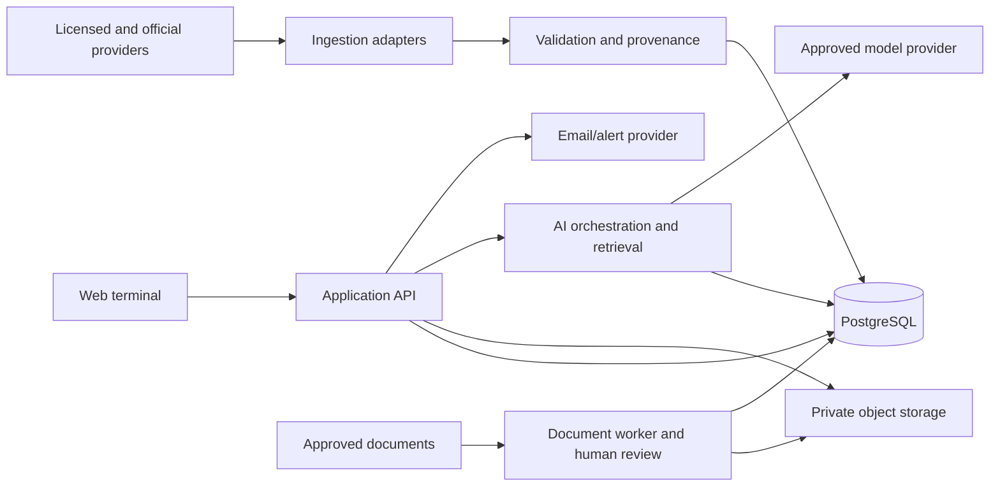

# Architecture and Data Model

## Recommended system shape

Start with a modular monolith and managed PostgreSQL. Keep the web/API application, ingestion worker and document-processing worker as deployable processes with clear interfaces; do not split into many microservices before scale requires it.

### Modules

- **Identity and tenancy:** users, roles, organisations, memberships, plan entitlements.
- **Provider registry:** adapter configuration, credentials references, licence terms, allowed purposes and contact/renewal details.
- **Ingestion:** scheduled and manual jobs, immutable source payload references, normalization, validation, deduplication and correction history.
- **Financial domain:** companies, instruments, prices, fundamentals, economic observations, fixed-income terms/yields, corporate actions.
- **Research/content:** documents, articles, reports, workflow states, source citations and exports.
- **Intelligence:** retrieval, deterministic financial calculations, generated analyses, citations, safety policy and evaluation records.
- **User services:** search, watchlists, alerts, notifications and usage limits.
- **Administration:** approvals, audit logs, provider freshness and exception queues.

## Data lifecycle

1. An adapter obtains an allowed provider record and stores provider ID, source URI, retrieval time and original payload/reference.
2. Normalization maps source values into typed canonical records without losing original units, period labels or provider identifiers.
3. Validation checks schema, units, dates, duplicate keys, range anomalies and expected freshness. Failures are quarantined for review.
4. Approved observations become queryable; corrections append a version and retain the old value and reason.
5. The API returns value, source, as-of time, period, status and rights-aware display metadata together.
6. AI retrieves these records and citations; it does not source unsupported facts from model memory for numeric answers.

## Core relational model

Use PostgreSQL `numeric` for all financial values; avoid binary floating point. Normalize units/currencies and keep observed, published, retrieved and effective dates distinct.

| Entity | Key fields and relationships |
| --- | --- |
| `users`, `user_profiles` | Auth identity, profile and preferences |
| `organisations`, `organisation_members` | Tenant and membership role; private records include `organisation_id` |
| `roles`, `permissions`, `user_roles` | Platform and tenant-scoped authorization |
| `subscription_plans`, `subscriptions`, `entitlements` | Configurable plans, provider-neutral status and quotas |
| `data_providers`, `data_licenses` | Provider, contract reference, permitted products, display/redistribution rights, expiry |
| `ingestion_jobs`, `source_records`, `data_quality_checks` | Job status, source payload pointer/hash, retrieval time, validation outcomes |
| `companies`, `sectors`, `company_identifiers` | Canonical issuer identity and symbol/ISIN mappings with effective dates |
| `instruments` | Issuer, asset class, exchange, currency, instrument identifiers and lifecycle |
| `market_observations` | Instrument/series, observation time, `numeric` value, unit, currency, source record, rights and status |
| `market_snapshots`, `market_indices` | Index or market summaries; computed values record methodology/version |
| `financial_periods`, `financial_statement_lines` | Company, statement type, period start/end, filed/published date, line item, value, currency/unit, source and revision |
| `financial_metric_definitions`, `derived_metrics` | Formula/version, period alignment, inputs, output and calculation timestamp |
| `economic_series`, `economic_observations` | Indicator definition and dated/revisable observations |
| `fixed_income_terms`, `auction_events`, `auction_results`, `yield_observations` | Issue terms, event dates, result type and yield basis clearly distinguished |
| `corporate_actions` | Issuer/instrument, event type, announcement/effective dates and source |
| `documents`, `document_extractions`, `document_chunks` | Private object pointer, rights, extracted text/table, page references, review state and reviewer |
| `news_items`, `research_reports`, `citations` | Source link, author, publication and approval status; citations resolve to source record/document page |
| `watchlists`, `watchlist_items`, `alerts`, `notifications` | Owner/tenant, rule, delivery state and history |
| `ai_conversations`, `ai_messages`, `ai_citations`, `ai_runs` | User/tenant, model/prompt version, retrieved evidence, output, cost and evaluation status |
| `audit_logs`, `api_keys`, `usage_records` | Actor, action, target, request metadata and usage/entitlement accounting |

### Integrity and indexing

- Unique constraints on provider + provider record ID + version; canonical identifier effective-date uniqueness.
- Foreign keys from observations, statements, reports and AI citations to provenance records.
- Time-series indexes on `(instrument_id, observation_at)` and `(series_id, observation_period_end)`; company-period indexes on financial statements.
- Partial indexes for active alerts, pending reviews and latest approved observations.
- Tenant row-level security for organisation-owned records; server-side permission checks remain mandatory.
- Partition large observation tables by date after measured growth justifies it.
- Store uploaded documents in private object storage; database holds object key, checksum and classification.

## API boundaries

Versioned REST endpoints should return typed domain records, not provider payloads. Example groups: `/v1/markets`, `/v1/companies`, `/v1/economy`, `/v1/fixed-income`, `/v1/news`, `/v1/research`, `/v1/search`, `/v1/assistant`, `/v1/watchlists`, `/v1/admin/providers`.

Provider adapters implement a common interface such as `fetch(cursor, window)`, `normalize(record)`, `validate(record)` and `rights(product, use)`. Secrets are injected server-side from a secret manager/environment and never serialized into frontend bundles or logs.

## Initial technology direction

- Next.js + React + TypeScript web application.
- PostgreSQL (Supabase is a reasonable managed starting option), migrations and row-level security where appropriate.
- Separate scheduled ingestion/document workers; Python is suitable for document extraction if needed.
- Private object storage for source documents and exports.
- Provider-neutral AI orchestration with retrieval and structured outputs.
- Financial charting library selected after data licensing and accessibility requirements are confirmed.
- Hosting selected after region, recovery, privacy and cost review. Avoid committing to an unverified vendor configuration.
