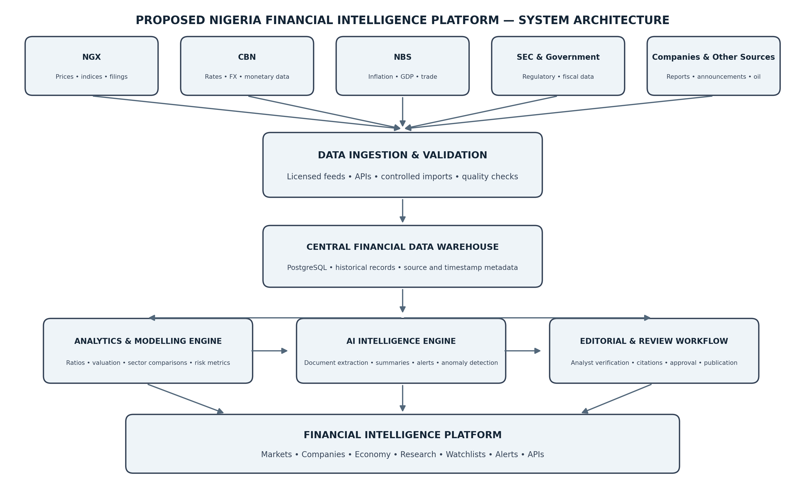

**NIGERIA FINANCIAL\
INTELLIGENCE PLATFORM**

Product, Technology, Data & Implementation Blueprint

*A proposed roadmap for building a trusted, Nigeria-focused financial
and economic intelligence platform.*

Prepared: November 2026

# 1. Executive Overview

The proposed platform is a Nigeria-focused financial intelligence
service designed to help investors, analysts, businesses and
institutions understand the Nigerian capital market and the wider
economy. Its ambition is to provide a dependable, professional source of
market data, company information, economic indicators, research and
analytical tools.

The recommended strategy is to build a focused, high-quality minimum
viable product (MVP) first. The platform should not attempt to reproduce
every feature of a global terminal at launch. It should establish trust
through licensed data, transparent sourcing, reliable calculations,
clear methodology and analyst-reviewed research.

# 2. Product Vision and Positioning

Suggested positioning: "Nigeria's Financial Intelligence Platform." The
product should help a user answer the question: What is happening in
Nigeria's markets and economy, why is it happening, and what does it
mean?

## Core audiences

- Retail investors seeking understandable market information and company
  research.

- Professional investors, analysts and portfolio managers requiring
  deeper data and comparisons.

- Banks, asset managers, pension funds, research institutions and other
  organisations.

- International investors who need a reliable overview of Nigeria's
  economy and capital markets.

# 3. Core Product Modules

  -----------------------------------------------------------------------
  **Module**                          **Scope**
  ----------------------------------- -----------------------------------
  **Markets**                         NGX equities, indices, sector
                                      performance, gainers and losers,
                                      volume, traded value, market
                                      capitalisation, historical charts
                                      and corporate actions.

  **Companies**                       Company profiles, financial
                                      statements, earnings, ratios,
                                      valuation, dividends, ownership
                                      information, filings, announcements
                                      and analyst commentary.

  **Economy**                         Inflation, GDP, exchange rates,
                                      interest rates, oil indicators,
                                      public debt, money supply, trade,
                                      government finances and monetary
                                      policy.

  **Research & News**                 Market commentary, company
                                      analysis, economic explainers,
                                      sector reports, event coverage and
                                      research archives.

  **Watchlists & Alerts**             Personal watchlists and
                                      notifications for price movements,
                                      company announcements, earnings,
                                      dividends and macroeconomic
                                      releases.

  **Professional & Institutional      Advanced comparisons, downloadable
  Tools**                             reports, APIs, bulk data access and
                                      customised dashboards. These should
                                      follow after the MVP proves demand.
  -----------------------------------------------------------------------

# 4. Proposed System Architecture

The architecture separates source data, validation, storage, analytics,
AI-assisted processing, human review and customer-facing products. This
separation makes the platform easier to maintain, audit and expand.

{width="6.8in"
height="4.1634120734908135in"}

*Figure 1. Proposed high-level architecture.*

## Architecture layers

**Data sources:** Licensed NGX feeds and data products; CBN and NBS
publications; SEC and government sources; company reports and
announcements; and other properly licensed industry data.

**Ingestion and validation:** Secure API integrations, scheduled imports
and controlled manual uploads. Validate formats, timestamps, missing
values, duplicates and outliers before publication.

**Central data warehouse:** A structured database holding current and
historical values, company identifiers, source references, publication
dates, update frequency and data lineage.

**Analytics and modelling:** Financial ratios, valuation calculations,
historical comparisons, sector metrics, economic dashboards and
carefully documented models.

**AI intelligence:** Document extraction, report summaries,
classification, anomaly detection and draft alerts. AI outputs must be
checked against source records.

**Editorial and review:** Analyst review, citations, methodology notes,
approval workflow and publication controls.

**Delivery:** Responsive website, user dashboards, alerts, downloadable
research and, later, APIs and institutional access.

# 5. Recommended Technology Stack

  -----------------------------------------------------------------------
  **Layer**                           **Recommendation**
  ----------------------------------- -----------------------------------
  **Frontend**                        Next.js, React and TypeScript;
                                      responsive user interface;
                                      accessible components; charting
                                      library; progressive web app
                                      support where useful.

  **Backend**                         Python with FastAPI for data
                                      services and analytical APIs.
                                      TypeScript/Node.js can be used
                                      where it best fits the product
                                      team.

  **Database**                        PostgreSQL for structured market,
                                      company and economic data. Redis
                                      for caching and queues where
                                      required.

  **Data processing**                 Python-based ETL pipelines,
                                      scheduled jobs, validation rules
                                      and monitoring.

  **Infrastructure**                  Cloud hosting, managed database
                                      backups, secrets management,
                                      logging, monitoring, staging and
                                      production environments.

  **Security**                        Role-based access control, MFA for
                                      privileged users, encryption in
                                      transit and at rest, audit logs,
                                      secure API keys and tested backup
                                      recovery.
  -----------------------------------------------------------------------

# 6. Data Strategy and Trust Framework

Data quality is a core product feature, not merely a backend concern.
Every material figure should be traceable to a source and a reference
period.

- Obtain written permission and the correct licence for any market data
  that will be displayed, redistributed or used commercially.

- Record source, timestamp, reference period, frequency, unit, currency
  and methodology for each dataset.

- Keep raw source records separately from cleaned and calculated
  records.

- Run automated checks for missing values, duplicate records, unexpected
  movements and stale feeds.

- Display whether a value is real-time, delayed, end-of-day, historical
  or manually updated.

- Provide correction procedures and retain an audit trail when published
  data is amended.

## Potential source categories

- Nigerian Exchange (NGX): market prices, indices, trading statistics,
  corporate actions and company disclosures, subject to applicable data
  agreements.

- Central Bank of Nigeria (CBN): monetary policy, exchange-rate and
  financial-system publications.

- National Bureau of Statistics (NBS): inflation, GDP, trade and other
  official statistics.

- SEC Nigeria and other public agencies: regulatory information and
  publications.

- Listed companies: annual reports, interim results, investor
  presentations and official announcements.

# 7. AI and Research Workflow

AI should assist analysts rather than act as an unverified source of
financial facts. The recommended workflow is: source document or
licensed data → extraction → validation against stored records →
AI-generated draft or insight → analyst review → approved publication.

- Summarise annual reports and results announcements with links to the
  original documents.

- Compare company financials and highlight changes in key metrics.

- Detect unusual movements or inconsistencies for analyst investigation.

- Draft plain-language explanations of economic releases.

- Generate alert candidates when defined market or macroeconomic
  thresholds are crossed.

Do not publish AI-generated investment conclusions or numerical claims
without verification. Clearly distinguish factual data, calculated
metrics, analyst opinion and automated commentary.

# 8. MVP Scope and Delivery Plan

**Phase 0 --- Discovery and validation (2--3 weeks)**

Confirm target users, product scope, data rights, regulatory boundaries,
source availability, success measures and budget.

**Phase 1 --- Foundation (3--5 weeks)**

Design the data model, authentication, admin tools, ingestion pipeline,
source metadata and initial website design.

**Phase 2 --- MVP build (6--10 weeks)**

Deliver markets, company profiles, economic dashboard, charts, research
publishing, watchlists and basic alerts.

**Phase 3 --- Quality and launch (2--4 weeks)**

Test data accuracy, security, performance, mobile experience, backups,
editorial workflow and user onboarding.

**Phase 4 --- Expansion (after launch)**

Add advanced financial models, deeper historical datasets, premium
research, institutional dashboards and APIs based on user demand.

# 9. People Required

  -----------------------------------------------------------------------
  **Role**                            **Responsibility**
  ----------------------------------- -----------------------------------
  **Founder / Product owner**         Sets direction, priorities,
                                      partnerships, commercial model and
                                      approvals.

  **Lead full-stack developer**       Owns application architecture,
                                      frontend, backend integration and
                                      delivery.

  **Data/backend engineer**           Builds ingestion pipelines, data
                                      models, validation, APIs and
                                      database operations.

  **Financial analyst / economist**   Defines metrics, validates
                                      calculations, develops research and
                                      reviews financial content.

  **UI/UX designer**                  Creates a clear, credible and
                                      responsive experience; can be
                                      part-time during the MVP.

  **DevOps / security specialist**    Sets up deployment, monitoring,
                                      access controls, backups and
                                      security reviews; can be part-time
                                      initially.

  **Legal / regulatory adviser**      Reviews data licensing, terms,
                                      disclaimers, privacy and whether
                                      planned activities require
                                      regulatory authorisation.
  -----------------------------------------------------------------------

# 10. Indicative Budget

The figures below are planning estimates, not supplier quotations. Final
costs depend on scope, team seniority, data licences, hosting choices,
compliance advice and whether development is performed in-house or
outsourced.

  -----------------------------------------------------------------------
  **Stage**               **Indicative budget**   **Scope**
  ----------------------- ----------------------- -----------------------
  **Prototype**           ₦3m--₦7m                Basic website, limited
                                                  datasets, manual
                                                  imports and simple
                                                  charts. Not a full
                                                  institutional product.

  **Serious MVP**         ₦10m--₦25m              Recommended starting
                                                  range for a secure,
                                                  well-designed platform
                                                  with a structured data
                                                  layer, core modules and
                                                  licensed data
                                                  allowance.

  **Expanded platform**   ₦30m--₦100m+            Broader datasets,
                                                  institutional tools,
                                                  APIs, advanced
                                                  analytics, more staff
                                                  and stronger
                                                  operational controls.
  -----------------------------------------------------------------------

A practical planning target is ₦15m--₦20m for Phase 1, provided data
licensing and the exact MVP scope are confirmed before committing funds.
Budget separately for ongoing hosting, data subscriptions, maintenance,
research staff and customer support.

# 11. Revenue Model

- Public access: free headlines, selected market information and basic
  economic indicators to build reach.

- Investor Pro: paid subscriptions for deeper company analysis, advanced
  charts, alerts, premium research and downloadable reports.

- Institutional: annual contracts for dashboards, APIs, bulk data,
  tailored research and enterprise support.

- Research services: commissioned reports or data services, subject to
  appropriate legal and regulatory review.

Pricing should be tested with target customers. Any distribution of
third-party market data must comply with the relevant licence and
redistribution terms.

# 12. Regulatory, Legal and Operational Considerations

- Obtain legal advice on the boundary between general financial
  information/research and regulated investment advice, securities
  dealing, portfolio management or other capital-market activities.

- Do not execute trades or hold client funds as part of the initial
  product.

- Use licensed market-data sources and comply with display,
  redistribution, attribution and derived-data conditions.

- Publish clear terms of use, privacy notice, risk disclosures,
  corrections policy and methodology notes.

- Protect user information and maintain security, retention and
  incident-response procedures.

This blueprint is a product and technology planning document, not legal
advice. Regulatory obligations must be confirmed with qualified Nigerian
counsel and the relevant authorities before launch.

# 13. Recommended First 90 Days

1.  Appoint a product owner and financial subject-matter lead.

2.  Agree the exact MVP modules and define what will not be included in
    version one.

3.  Request written data quotations and licensing terms from NGX and
    other required providers.

4.  Interview prospective users: retail investors, analysts, asset
    managers and institutional buyers.

5.  Complete wireframes, database design, source register and
    data-quality policy.

6.  Build and test the data ingestion foundation before expanding the
    user interface.

7.  Launch a controlled beta with a small group and measure accuracy,
    usefulness, retention and willingness to pay.

# 14. Success Measures

- Data freshness and percentage of records passing validation.

- Accuracy of financial calculations against source documents.

- Availability, page performance and alert delivery reliability.

- Active users, returning users and watchlist engagement.

- Research readership and user feedback.

- Paid conversion, subscription retention and institutional sales
  pipeline.

# 15. Closing Recommendation

Build the platform around a dependable Nigerian financial data
foundation, then add analytics, research and AI-assisted intelligence on
top. Start with NGX market coverage, key company profiles, core economic
indicators, charts, research publishing, watchlists and alerts. Keep the
first release focused, validate data rights and regulatory boundaries
early, and expand into institutional products only after the MVP
demonstrates reliability and market demand.

# Planning Notes

All budget figures and delivery durations are indicative and should be
validated through quotations and technical discovery. Data-provider
pricing, licensing scope and regulatory requirements can change. Confirm
current terms directly with each provider before procurement.
