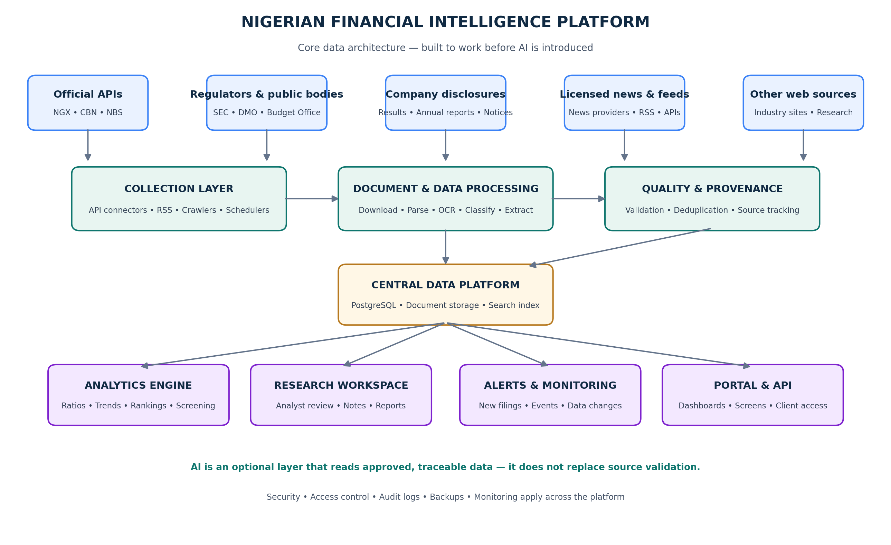
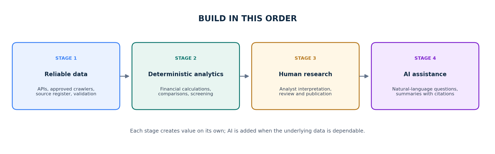

**BUILDING A NIGERIAN\
FINANCIAL INTELLIGENCE PLATFORM**

Data acquisition, processing, analytics and AI architecture

*A practical technical blueprint for a platform focused initially on the
Nigerian financial market*

{width="7.1in"
height="4.349748468941383in"}

**Core recommendation: build the data foundation and analytical engine
first. Add AI as a controlled intelligence layer later.**

# 1. Executive summary

The proposed platform should be designed as a Nigerian-market financial
data and research system, not simply as a financial-news website. Its
core capability will be to collect information from trusted sources,
standardise it, validate it, store it with a clear audit trail, and turn
it into useful market analytics, research and investor-facing tools.

Artificial intelligence is not required to build the initial collection
and processing engine. APIs, scheduled jobs, web crawlers, document
parsers, database rules and conventional software can perform most of
the foundational work. AI can be introduced later to help users query
the platform, summarise documents and explore trends, using approved
data as its evidence base.

- Build a reliable and traceable data foundation before investing
  heavily in AI.

- Prioritise official and licensed sources over unverified internet
  content.

- Keep raw source documents and original values so extracted data can be
  checked.

- Separate factual data, calculated metrics, analyst opinions and
  AI-generated explanations.

- Treat market-data licensing, redistribution rights and source terms as
  core product requirements.

# 2. What the platform needs to do

The platform\'s data engine should be able to:

- Monitor selected financial, regulatory, economic and
  company-information sources.

- Detect new data releases, filings, corporate announcements and
  relevant publications.

- Collect information through APIs, permitted web crawling, RSS feeds
  and document downloads.

- Extract structured data from tables, spreadsheets, HTML pages and PDF
  documents.

- Standardise company names, tickers, dates, currencies, reporting
  periods and units.

- Validate records, detect duplicates and flag unusual or incomplete
  values.

- Store both the original source material and the cleaned, structured
  data.

- Power financial calculations, screening, charts, alerts, research and
  user-facing dashboards.

# 3. Illustrated system architecture

The diagram below shows the recommended flow. Different source types
enter through collection connectors. Processing and quality controls
prepare the information before it is stored centrally. Analytics,
research, alerts and the portal then use the approved data.

{width="7.15in"
height="4.380379483814523in"}

*Figure 1. High-level architecture for the Nigerian Financial
Intelligence Platform.*

## 3.1 Main architecture components

  -----------------------------------------------------------------------
  **Component**                       **Purpose**
  ----------------------------------- -----------------------------------
  **Source layer**                    Official APIs, regulator websites,
                                      company investor-relations pages,
                                      licensed news feeds, RSS feeds and
                                      selected industry sources.

  **Collection layer**                Python-based API connectors and
                                      crawlers, scheduled jobs, change
                                      detection, retry handling and rate
                                      limiting.

  **Processing layer**                Document download, HTML parsing,
                                      PDF/table extraction, OCR where
                                      necessary, classification, field
                                      extraction and normalisation.

  **Quality and provenance layer**    Validation rules, duplicate
                                      detection, source metadata,
                                      timestamps, confidence/verification
                                      status and review queues.

  **Central data platform**           PostgreSQL for structured records;
                                      object storage for original
                                      documents; a search index for fast
                                      discovery where needed.

  **Analytics and product layer**     Financial ratios, company
                                      comparisons, sector analysis,
                                      market screens, charts, alerts,
                                      analyst workspace and portal APIs.

  **Cross-cutting controls**          Authentication, role-based access,
                                      encryption, audit logs, backups,
                                      monitoring, secrets management and
                                      disaster recovery.
  -----------------------------------------------------------------------

# 4. Data sources and source hierarchy

The platform should not treat every website as equally authoritative.
Each source should be registered, classified and assigned a permitted
collection method. The source hierarchy below is a recommended starting
point.

  -----------------------------------------------------------------------
  **Source tier**         **Examples**            **How to use it**
  ----------------------- ----------------------- -----------------------
  **Primary /             NGX, CBN, NBS, SEC,     Core factual records;
  authoritative**         Debt Management Office, retain original
                          Budget Office, relevant documents and
                          ministries and          publication dates.
                          listed-company          
                          disclosures.            

  **Licensed professional Reuters, Bloomberg,     Use only under the
  sources**               Financial Times and     relevant licence; do
                          specialist              not assume a
                          data/research           subscription permits
                          providers, subject to   republishing.
                          subscription and        
                          redistribution rights.  

  **Secondary / industry  Industry associations,  Useful for context,
  sources**               company websites,       discovery and
                          reputable Nigerian      corroboration; record
                          financial publications  source quality.
                          and research houses.    

  **Open web / discovery  Selected blogs, public  Treat as leads or
  sources**               commentary and social   commentary, not
                          platforms where         verified financial
                          permitted.              facts.
  -----------------------------------------------------------------------

## 4.1 Build a source registry

Maintain a registry for every monitored source. Suggested fields:

- Source ID, source name, organisation and source category.

- Authority level and the data types it provides.

- Official URL or API endpoint and the permitted access method.

- Collection frequency, last successful check and next scheduled check.

- Licence/terms status, redistribution restrictions and contact details.

- Reliability notes, parser owner, failure alerts and review history.

# 5. How information is processed without AI

A rules-based pipeline can process many recurring financial tasks
reliably. AI may assist with difficult unstructured documents later, but
basic extraction, validation and calculation should be deterministic
wherever possible.

**1. Detect ---** A scheduled connector checks an official API, RSS feed
or permitted page for a new release.

**2. Collect ---** The system downloads the data or document and records
its URL, source, timestamp and file hash.

**3. Classify ---** Rules and metadata identify the company, document
type, reporting period and relevant topic.

**4. Extract ---** Parsers read structured tables and fields. OCR is
used only when a document is scanned.

**5. Normalise ---** Values are converted into consistent units,
currencies, date formats, company identifiers and reporting periods.

**6. Validate ---** Rules check required fields, arithmetic
relationships, duplicates, unexpected changes and missing values.

**7. Review ---** Low-confidence or unusual records are placed in a
human review queue before publication.

**8. Store and publish ---** Approved records are stored with their
source references and made available to analytics and the portal.

## 5.1 Example: processing a company results announcement

When a listed company publishes its full-year results, the system could:

1.  Detect and download the announcement or financial statement.

2.  Identify the issuer, financial year and document type.

3.  Extract revenue, profit before tax, profit after tax, EPS, dividend,
    assets, liabilities and other relevant fields.

4.  Compare extracted values with the original document and prior
    periods.

5.  Run validation checks and flag inconsistencies for analyst review.

6.  Store the approved values alongside the original PDF and source URL.

7.  Update company dashboards, comparison tables and relevant alerts.

# 6. Analytics engine: calculations before AI

The analytics engine should calculate metrics from approved source data
using documented formulas. It should retain the formula version, input
records and calculation timestamp so results can be reproduced.

  -----------------------------------------------------------------------
  **Metric**                          **Illustrative formula**
  ----------------------------------- -----------------------------------
  **Revenue growth**                  (Current-period revenue −
                                      Prior-period revenue) ÷
                                      Prior-period revenue

  **Profit growth**                   (Current-period profit −
                                      Prior-period profit) ÷ Prior-period
                                      profit

  **Return on equity (ROE)**          Net income ÷ Average shareholders\'
                                      equity

  **Price-to-earnings (P/E)**         Market price per share ÷ Earnings
                                      per share

  **Dividend yield**                  Dividend per share ÷ Share price

  **Debt-to-equity**                  Total debt ÷ Shareholders\' equity
  -----------------------------------------------------------------------

Important: financial metrics require consistent definitions. For
example, earnings per share may be basic or diluted, and period
comparisons may need to account for restatements, changes in accounting
policy, share splits and fiscal-year differences.

# 7. Recommended technology stack

  -----------------------------------------------------------------------
  **Area**                            **Recommended starting point**
  ----------------------------------- -----------------------------------
  **Backend and collection**          Python; FastAPI for internal
                                      services; Requests/httpx;
                                      BeautifulSoup; Scrapy; Playwright
                                      only where permitted and necessary.

  **Data processing**                 Pandas or Polars; NumPy; PDF/table
                                      extraction libraries; OCR for
                                      scanned documents.

  **Database**                        PostgreSQL for structured financial
                                      and reference data.

  **Document storage**                S3-compatible object storage for
                                      original PDFs, spreadsheets and
                                      downloaded source files.

  **Search**                          PostgreSQL full-text search
                                      initially; OpenSearch/Elasticsearch
                                      when scale and search requirements
                                      justify it.

  **Scheduling and queues**           A task scheduler and background
                                      worker/queue for recurring
                                      collection, retries and processing.

  **Frontend**                        A modern web application using
                                      React/Next.js or an equivalent
                                      framework.

  **Infrastructure**                  Cloud hosting, Docker, automated
                                      deployment, monitoring, backups and
                                      secure secret storage.
  -----------------------------------------------------------------------

# 8. Where AI fits --- and where it does not

AI should be an additional interpretation and interaction layer, not the
source of truth. The platform\'s database, source references, validation
rules and calculation engine remain responsible for factual integrity.

  -----------------------------------------------------------------------
  **Area**                            **Recommended treatment**
  ----------------------------------- -----------------------------------
  **Good uses for AI**                Natural-language questions over
                                      approved data; document
                                      summarisation; extracting candidate
                                      fields from complex documents;
                                      explaining trends; drafting
                                      research summaries; semantic
                                      search.

  **Keep deterministic**              Market prices, financial
                                      calculations, ratios, ranking
                                      logic, date handling, source
                                      timestamps, permissions and final
                                      data validation.

  **Human oversight**                 Analyst review of important
                                      research, unusual extracted values,
                                      investment commentary and material
                                      claims before publication.

  **Required safeguards**             Citations to source records, clear
                                      data dates, uncertainty labels,
                                      access controls, logging and a way
                                      to inspect the underlying evidence.
  -----------------------------------------------------------------------

# 9. Implementation roadmap

{width="7.1in"
height="2.208490813648294in"}

*Figure 2. Recommended build sequence.*

**Stage 1 --- Data foundation:** Set up the database, source registry,
document storage, collection connectors, validation, audit trail and a
small number of high-value Nigerian sources.

**Stage 2 --- Analytics:** Build company financial histories, ratios,
market screens, sector comparisons, economic indicators, charts and
alerts.

**Stage 3 --- Research workflow:** Add analyst workspaces, research
notes, document review, publication workflow, event calendars and
client-facing research.

**Stage 4 --- AI intelligence layer:** Add question-answering and
summarisation over approved platform data, with citations, permissions
and human review.

# 10. Initial team and responsibilities

  -----------------------------------------------------------------------
  **Role**                            **Main responsibility**
  ----------------------------------- -----------------------------------
  **Technical lead / full-stack       Own architecture, backend,
  developer**                         database, portal integration,
                                      deployment, security coordination
                                      and technical delivery.

  **Data engineer**                   Build connectors, document
                                      pipelines, data models,
                                      normalisation, validation and
                                      monitoring.

  **Financial analyst / research      Define financial metrics, validate
  lead**                              extracted information, set research
                                      standards and approve analytical
                                      outputs.

  **Market-data / compliance          Review data licences, exchange
  adviser**                           rules, redistribution permissions,
                                      source terms and regulatory
                                      considerations.

  **UI/UX designer (project-based)**  Design investor dashboards, company
                                      pages, data tables, charts and
                                      research workflows.
  -----------------------------------------------------------------------

# 11. Key risks and controls

  -----------------------------------------------------------------------
  **Risk**                            **Control**
  ----------------------------------- -----------------------------------
  **Licensing and redistribution**    Confirm written rights before
                                      collecting, storing, displaying or
                                      redistributing market data and
                                      third-party content.

  **Website changes and blocked       Prefer official APIs and feeds; use
  crawlers**                          permitted crawling, robust
                                      monitoring and parser maintenance.

  **Incorrect extraction**            Retain original documents, validate
                                      values, compare with previous
                                      periods and route exceptions to
                                      human review.

  **Duplicate or conflicting          Use stable identifiers, source
  records**                           precedence rules, timestamps and
                                      version history.

  **Stale data**                      Display data timestamps and
                                      frequency; monitor failed
                                      collection jobs and delayed
                                      releases.

  **Security and privacy**            Protect credentials, use
                                      server-side integrations,
                                      role-based access, encryption,
                                      audit logs and backups.

  **AI hallucinations**               Restrict AI to approved records,
                                      require source citations and
                                      prevent it from silently changing
                                      the underlying database.
  -----------------------------------------------------------------------

# 12. Cost and scope considerations

The earlier working estimate discussed for the initial build was
approximately ₦15m--₦20m. That should be treated as a planning envelope,
not a supplier quotation or guaranteed delivery price. The final budget
depends on the number of data sources, licensing, historical-data
access, intraday requirements, hosting, security expectations and the
depth of the analytics.

- Do not purchase every exchange data package at the beginning. Identify
  the minimum datasets required for the MVP.

- Prioritise end-of-day and historical data if the initial product does
  not require real-time trading screens.

- Request written quotations and redistribution terms from data
  providers.

- Budget for ongoing data subscriptions, cloud hosting, monitoring and
  maintenance---not just initial development.

- Keep the first release narrow: a small set of companies, core economic
  indicators and a clear research workflow.

# 13. Recommended MVP scope

A realistic first release should prove that the platform can reliably
collect, process and present useful Nigerian-market information.

- A source registry and controlled collection pipeline.

- A structured company database with historical financial statements for
  a defined initial universe.

- A basic NGX market-data integration under the correct licence.

- Selected CBN and NBS economic indicators.

- Company profile pages and financial-history tables.

- Core ratios, growth calculations and peer comparisons.

- A document library with source links and publication dates.

- An analyst review and approval workflow.

- A basic portal with search, dashboards and data freshness indicators.

# 14. Final recommendation

**Make the data foundation the platform\'s core intellectual property.**
The strongest long-term advantage will not come from having an AI
chatbot alone. It will come from having a well-structured, historically
rich, traceable and properly licensed Nigerian financial database,
supported by reliable analytics and experienced research review. AI can
then make that foundation easier to explore and more valuable to
investors.

# Appendix A --- Example source record

  -----------------------------------------------------------------------
  **source_id**                       CBN_STATISTICS
  ----------------------------------- -----------------------------------
  **source_name**                     Central Bank of Nigeria statistics

  **source_type**                     Official institutional source

  **data_category**                   Economic / monetary statistics

  **collection_method**               Official API or permitted download

  **collected_at**                    Timestamp recorded automatically

  **published_at**                    Publication timestamp where
                                      supplied

  **source_url**                      Original source page or document
                                      URL

  **verification_status**             Pending / validated / reviewed

  **licence_status**                  Terms reviewed / approval required
  -----------------------------------------------------------------------

# Appendix B --- Important implementation note

This document is a conceptual architecture and planning blueprint.
Before implementation, confirm current API availability, data fields,
access conditions, commercial licensing, redistribution rights and
technical documentation directly with each provider. Do not assume that
publicly viewable information is automatically free to scrape, store or
redistribute.
